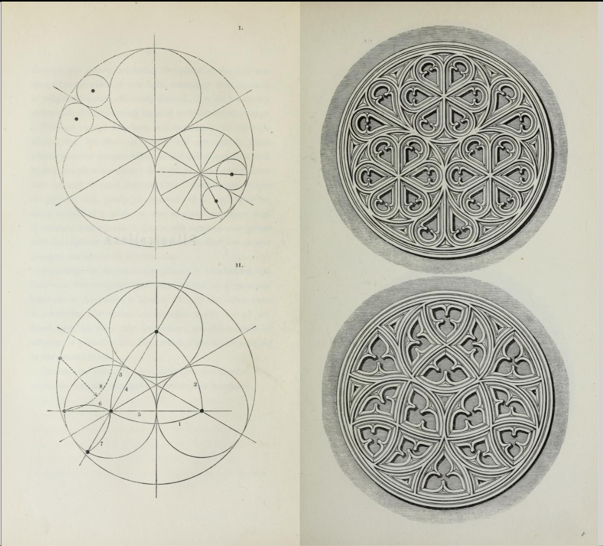
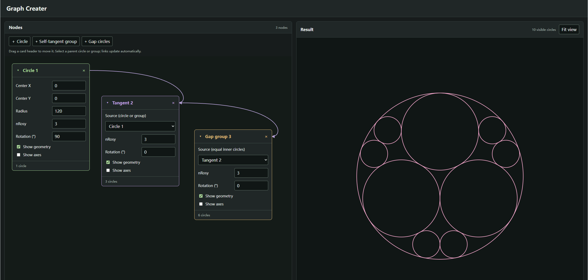

<style>
    @media screen and (min-width: 76em) {
        .md-sidebar--primary {
            display: none !important;
        }
    }
</style>

# Suivi de projet

## Semaine 1 (31 août–6 septembre 2026)

### Objectifs de la période

- Clarify the main objectives of the project and the tools to be used during development.

### Travail réalisé

Met with the professor to confirm the project's main objectives and the tools to use throughout the project.



*Reference examples showing geometric constructions and their corresponding Gothic tracery patterns.*

---

## Semaine 2 (7–13 septembre 2026)

### Objectifs de la période

- Establish the basic framework of the modeling language.
- Generate simple geometric elements, including points, axes, and circles, and experiment with symmetry and rotation.

### Travail réalisé

Developed the first version of the modeling language using JavaScript. This version used code input as the main way to create and edit geometric constructions.

For example:

```javascript
A = point(0, 0)
B = circle(A, 20, 4)
```

Here, `A` is a point at the origin and serves as the center of circle `B`. The value `20` specifies the radius, while `4` specifies `nRosy`, the rotational symmetry order.

---

## Semaine 3 (14–20 septembre 2026)

### Objectifs de la période

- Extend the modeling language to generate more complex constructions.
- Generate a corresponding number of circles based on the number of axes.

### Travail réalisé

Implemented circle generation by calculating the positional relationship between a circle and an axis. Applying this calculation to each axis made it possible to determine and render all the corresponding circles.

### Difficultés rencontrées

Although this approach worked for the implemented construction, extending it to more complex structures, such as multiple levels of nested circles, was expected to make the calculations increasingly difficult to organize and manage. Code-based input also made it difficult to identify the dependencies within the current geometric construction.

### Décisions et ajustements

Decided to replace code-based input with visual control modules. This approach was intended to make existing shapes easier to update and dependencies between modules easier to identify.

---

## Semaine 4 (21–27 septembre 2026)

### Objectifs de la période

- Rebuild the implementation around visual control modules.
- Add connections between modules to represent their dependencies.

### Travail réalisé

Reimplemented the functionality developed during the previous weeks as visual control modules and added connections between them. The existing functionality remained available, while dependencies between modules became easier to identify.



*Week 4 prototype: connected control modules on the left and the resulting geometry on the right.*
