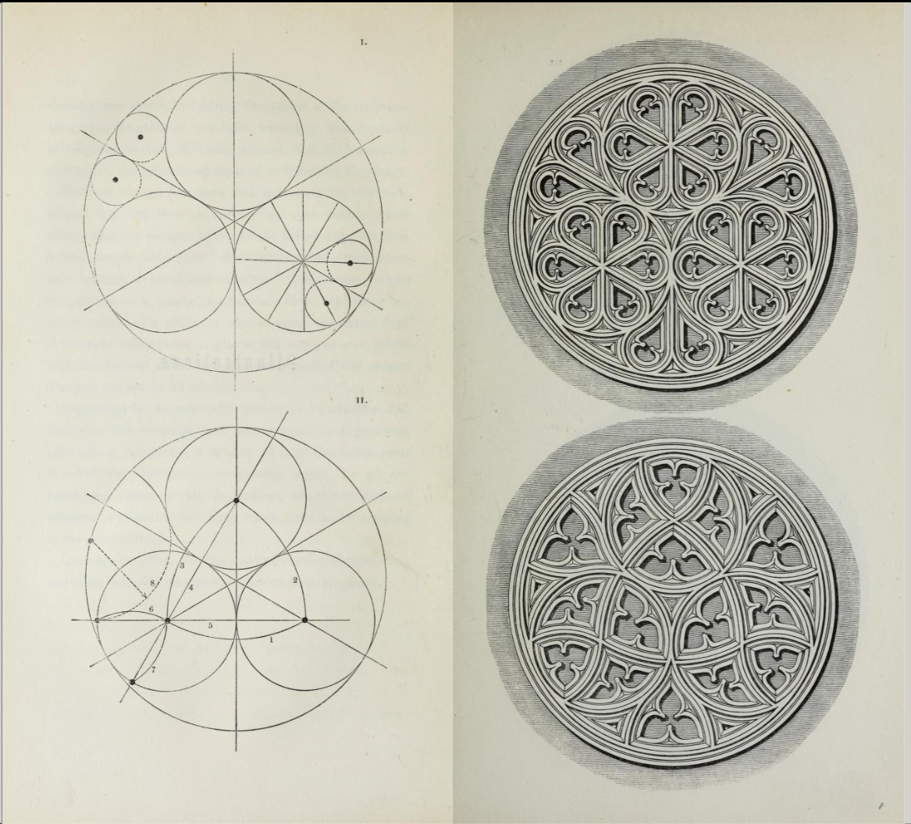
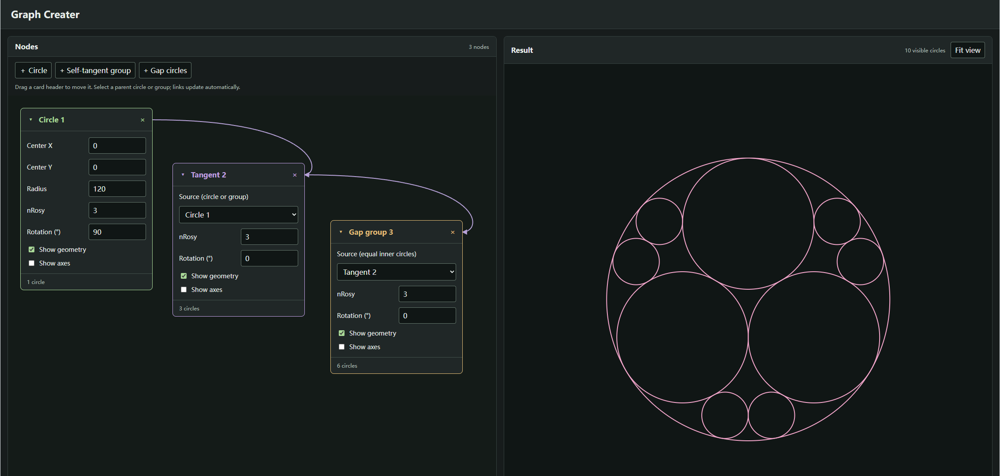

<style>
    @media screen and (min-width: 76em) {
        .md-sidebar--primary {
            display: none !important;
        }
    }
</style>

# Suivi de projet

## Semaine 1 (31 août–6 septembre 2026)

### Objectifs de la période

- Clarify the main objectives of the project and the tools to be used during development.

### Travail réalisé

Met with the professor to confirm the project's main objectives and the tools to use throughout the project.



*Reference examples showing geometric constructions and their corresponding Gothic tracery patterns.*

---

## Semaine 2 (7–13 septembre 2026)

### Objectifs de la période

- Establish the basic framework of the modeling language.
- Generate simple geometric elements, including points, axes, and circles, and experiment with symmetry and rotation.

### Travail réalisé

Developed the first version of the modeling language using JavaScript. This version used code input as the main way to create and edit geometric constructions.

For example:

```javascript
A = point(0, 0)
B = circle(A, 20, 4)
```

Here, `A` is a point at the origin and serves as the center of circle `B`. The value `20` specifies the radius, while `4` specifies `nRosy`, the rotational symmetry order.

---

## Semaine 3 (14–20 septembre 2026)

### Objectifs de la période

- Extend the modeling language to generate more complex constructions.
- Generate a corresponding number of circles based on the number of axes.

### Travail réalisé

Implemented circle generation by calculating the positional relationship between a circle and an axis. Applying this calculation to each axis made it possible to determine and render all the corresponding circles.

### Difficultés rencontrées

Although this approach worked for the implemented construction, extending it to more complex structures, such as multiple levels of nested circles, was expected to make the calculations increasingly difficult to organize and manage. Code-based input also made it difficult to identify the dependencies within the current geometric construction.

### Décisions et ajustements

Decided to replace code-based input with visual control modules. This approach was intended to make existing shapes easier to update and dependencies between modules easier to identify.

---

## Semaine 4 (21–27 septembre 2026)

### Objectifs de la période

- Rebuild the implementation around visual control modules.
- Add connections between modules to represent their dependencies.

### Travail réalisé

Reimplemented the functionality developed during the previous weeks as visual control modules and added connections between them. The existing functionality remained available, while dependencies between modules became easier to identify.



*Week 4 prototype: connected control modules on the left and the resulting geometry on the right.*

---

## Bilan de période (2 octobre–6 novembre 2026)

### Objectifs de la période

- Extend the visual prototype to construct rose-window patterns from reusable circles, arcs, tangency constraints, and rotational symmetry.
- Preserve construction dependencies when source parameters change.
- Make the node graph easier to understand and prepare an accessible prototype for the second project presentation.

### Travail réalisé

**Geometric construction.** Added self-tangent circle groups, gap circles, and circles defined by three tangency constraints. These operations allow simple circles and groups to serve as inputs to more complex constructions, rather than requiring every circle to be positioned manually.

**Arc construction and display.** Added arc construction, solid/dashed/hidden arc styles, and rotational arc groups. A single arc can be repeated around a reference center to build a symmetric pattern. Display controls make it possible to distinguish construction geometry from the portions intended to remain visible.

**Parametric dependencies.** Revised circle references to use a source node ID and member index. When a source parameter such as `nRosy` changes, dependent constructions retrieve the updated source circles and recompute their constraints. For example, a circle defined by tangency to members of a group can update when that group changes from three to four members, provided the referenced members and a valid selected solution still exist.

**Node graph structure.** Separated geometry nodes from function nodes. Geometry nodes describe circles, groups, and their properties; function nodes specify construction inputs and constraints. The graph now makes the sequence **Geometry → Function → Geometry** explicit, for example **Circle → Self tangent → Circle group**. Automatic graph layout improves the readability of the connections and makes reuse of a result by several operations easier to identify.

**Online prototype.** Published the geometric construction application on GitHub Pages by November 6, so it can be accessed without running a local server: [Graph Creater](https://huoyingxu.github.io/IFT3150/). The live application continues to evolve after this reporting period.

### Difficultés rencontrées et solutions

Two main difficulties guided the changes during this period:

- **Dependencies became invalid when `nRosy` changed.** Dependent constructions could disappear when the source group changed. Identifying source members by node ID and member index allowed valid references to be resolved against the updated geometry. This preserves the construction relationship, but does not guarantee a solution when a referenced member disappears or the constraints become incompatible.
- **Operations and results were mixed in the same node.** This made construction history and responsibilities difficult to read. Separating geometry and function nodes clarified inputs, outputs, and reuse, and made unexpected results easier to trace back to their construction steps.

### Résultat de la période

By the second presentation, the project had an online, node-based prototype capable of combining circles and arcs into reusable geometric constructions, updating dependent geometry, and displaying selected arc portions. The main achievement was a clearer construction model that supports parameter-driven variations of rose-window patterns.

### Prochaines étapes envisagées au 6 novembre

- Develop an interactive editor for selecting points, lines, and other geometric elements directly on the canvas to create custom constructions.
- Explore AI-assisted rendering that relates geometric frameworks to real rose-window images while preserving their underlying structure.

These were planned directions at the time of the second presentation, rather than completed features for this reporting period.

### Présentation de la deuxième mise en commun

[Download the second project presentation (PowerPoint)](assets/presentations/phase-2-november-2026.pptx)
